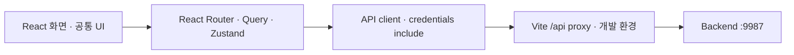

<div align="center">
  
  <h1>주점부리 · Frontend</h1>
  <p><strong>취향에 맞는 한 잔을 발견하고 기록하는 주류 큐레이션</strong></p>
  <p>상품 탐색·후기·데모 주문과 관리자 웹</p>
  <a href="https://github.com/Pubburi/Frontend/actions/workflows/ci.yml"></a>
    
</div>

<br />

## 📄 목차

- [프로젝트 개요](#overview)
- [현재 기능과 범위](#features)
- [기술 스택](#technology)
- [시스템 구조](#architecture)
- [문제 해결](#problem-solving)
- [로컬 실행](#development)
- [검증과 협업](#verification)
- [개발 계획](#roadmap)

<br />

<a id="overview"></a>

## ✍ 프로젝트 개요

상품을 탐색하고 후기를 확인하며 데모 주문을 생성하는 주점부리 웹입니다. Vite·React·TypeScript·React Router·TanStack Query·Zustand를 사용합니다.

<a id="features"></a>

## 🥃 현재 기능과 범위

| 영역 | 현재 제공 기능 |
|---|---|
| 홈·매장 | 배너, 주종 카테고리, 인기 상품, 매장 목록·현재 상세 위치 조회 |
| 탐색·상세 | 상품 검색·가격/도수 범위·맛/향 태그 필터·정렬·페이지 이동, 가격·도수·후기와 등록된 용량·설명·맛/향 태그·출처 조회 |
| 상품 비교 | 최대 네 상품 선택·해제, 현재 가격·도수·주종과 확인된 용량·맛/향·출처 비교, 비교 주소 복원 |
| 최근 본 상품 | 비회원 브라우저 기록 최대20개·30일, 로그인 중 메모리 기록, 현재 상품 다시 보기·기록 삭제/전체 삭제 |
| 회원·후기 | 회원가입·로그인, 본인 이름·비밀번호 수정, 평점과 후기 작성·수정·삭제 |
| 찜 | 상품 상세 저장·해제, 본인 찜 목록·페이지·현재 상품 링크 |
| 기본 둘러보기 | 설문 없이 기본 주류 조회·새로고침, 현재 상품 상세 이동 |
| 내 취향 | 본인 취향 설문·수정·건너뛰기·초기화, 선호와 반드시 지킬 범위 구분 |
| 비공개 취향 기록 | 상세에서 경험·관심 메모 작성, 본인 목록·수정·삭제, 개인 평점·맛/향과 삭제된 상품의 기록 보존 |
| 취향 검색 문구 | 이번 검색에 사용할 선호 선택, 저장한 필수 범위와 문구 확인·명시 적용, 빈 결과·검색 조건 해제 |
| 장바구니·주문 | 기기 내 장바구니 저장, 수량 수정, 데모 주문 접수·현재 상세/상태와 당시 금액 조회 |
| 마이·관리자 | 주문 내역·스탬프·등급, 상품·매장·회원·후기·주문 관리와 상품 특성·출처 편집 |

<a id="technology"></a>

## ⚙️ 기술 스택

| 분류 | 기술 스택 |
|---|---|
| 언어 | TypeScript · CSS |
| UI | React |
| 라우팅 | React Router |
| 서버 상태 | TanStack Query |
| 클라이언트 상태 | Zustand |
| 개발·빌드 | Vite · Node.js · npm |
| 정적 자산 | WebP · sharp |
| 테스트 | Vitest · jsdom · Playwright |
| CI | GitHub Actions |

<a id="architecture"></a>

## 🏛️ 시스템 구조



<a id="problem-solving"></a>

## 🧩 문제 해결

### 1. 주문 완료와 다음 장바구니 입력 분리하기

#### 문제

데모 주문을 전송한 뒤 다른 상품을 담거나 다음 요청사항을 작성하면, 이전 주문의 성공 처리가 아직 보내지 않은 입력까지 지웠다. 다른 화면으로 이동했어도 늦은 성공이 주문 내역으로 강제 이동시켰다. 서버에 접수된 주문과 이후 사용자의 선택을 함께 보존해야 했다.

#### 원인

API에는 제출 시점의 상품·수량·요청을 올바르게 보냈지만, 완료 시점에는 현재 장바구니 전체와 현재 요청사항을 무조건 초기화했다. 상품 ID만 비교해서 제출량을 빼면 삭제 후 다시 담은 같은 상품을 새 선택으로 구분할 수 없고, 입력값만 비교하면 같은 값으로 다시 작성한 새 폼도 지운다.

#### 해결

상품 행에 저장하지 않는 메모리 소유 토큰을 두고 제출할 때 수량·토큰·폼 객체를 캡처했다. 성공 뒤 같은 행에서 제출한 수량만 차감하며, 새 상품과 삭제 후 다시 담은 행은 남긴다. 요청사항은 여전히 제출 폼일 때만 비운다. 원래 장바구니 화면과 경로가 유지된 경우에만 주문 내역으로 이동하고, 접수 중 추가 수량과 새 요청은 다음 주문에 남는다는 의미를 안내한다. 기존 저장 키·배열 형식과 보관 실패의 분리는 유지했다.

#### 결과

접수된 원래 주문을 바꾸지 않으면서 추가 상품·수량과 새 요청사항으로 다음 주문을 이어갈 수 있다. 로컬 실제 서버 연동에서도 원래 제출 내용과 다음 입력을 함께 보존했고, 다른 화면이나 다시 연 장바구니를 이전 성공이 이동시키지 않는다. 변경하지 않은 정상 주문은 정리하고 거절된 주문의 현재 입력은 남긴다. 적용 조건과 한계는 작업 기록으로 구분했다.

#### 대체안/회고

주문 중 모든 담기·편집·이동을 막는 대신 이미 보낸 주문과 다음 선택의 소유를 나눴다. 값 비교나 전체 초기화로는 수량 추가·삭제 후 재추가·새 폼을 함께 다루지 못한다. 전송 후 수량을 줄여도 접수된 주문을 취소하는 것은 아니며 잔여량을 음수로 만들지 않는다. 전체 새로고침·여러 창의 주문 조정, 서버 멱등성과 계정 장바구니 병합은 별도 과제다. 브라우저 보관이 막힌 동안 새로고침 복원을 보장하지 않는다.

#### 코드

전송 후에는 같은 행의 제출량만 정리하고 다음 폼은 남긴다.

```ts
save(
  get().items.flatMap((item) => {
    const original = submitted.get(item.product.id)
    if (!original || lineOwners.get(item.product.id) !== original.owner)
      return [item]
    const quantity = Math.max(0, item.quantity - original.quantity)
    if (quantity > 0) return [{ ...item, quantity }]
    lineOwners.delete(item.product.id)
    return []
  }),
)
if (get().orderForm === orderForm)
  set({ orderForm: { ...orderForm, orderTable: '' } })
```

```tsx
if (result.ok) {
  // The order succeeded. A later profile/list refresh must not turn it into a failed order.
  void client.invalidateQueries({ queryKey: ['account', userId] })
  void client.invalidateQueries({ queryKey: ['catalog', 'popular'] })
  if (mounted.current && currentLocation.current === submittedLocation)
    navigate('/profile')
}
```


### 2. 검색·상세 경로별로 서버 상태를 분리해 늦은 응답 보호하기

#### 문제

기존 고객 탐색에서 검색 응답 전에 필터를 해제하면 최신 요청이 누락됐고, 진행 중 상세를 떠나 다른 상품으로 이동해도 새 상세를 표시하지 못했다. Vue에서 고친 이 사용자 결과를 React 전환에서도 보존해야 했다.

#### 원인

이전 읽기/쓰기 공용 중복 차단과 단일 catalog 상태는 최신 의도와 늦은 응답을 구분하지 못했다. 프레임워크만 바꾸고 같은 공용 응답 칸을 만들면 동일한 문제가 다시 생긴다.

#### 해결

TanStack Query에서 검색 조건 전체·상품 ID·후기 정렬·페이지를 query key에 포함한다. 화면은 현재 URL key를 구독하며 이전 응답은 이전 key의 캐시에만 저장된다. 상세 컴포넌트도 상품 ID로 구분해 수량·편집 상태가 다른 상품으로 섞이지 않게 하고, 읽기 오류는 해당 query의 화면에서 안내한다. 쓰기는 Zustand의 동기 pending 검사로 중복 실행을 차단한다.

#### 결과

검색 중 해제한 URL의 새 목록을 읽고, 떠난 상세의 늦은 성공·실패가 현재 상품이나 전역 오류를 바꾸지 않는다. 이전 읽기의 종료가 현재 읽기의 로딩 상태를 먼저 끄지도 않는다. 이는 응답 순서의 정확성 결과이며 네트워크 속도 개선 수치가 아니다.

#### 대체안/회고

전역 catalog에 응답을 복사하고 버전을 다시 관리하는 대신 query key가 서버 상태를 소유하게 했다. 고객/관리자 key와 개인 주문의 계정 ID도 분리한다. 현재 이전 GET 전송 자체는 취소하지 않으므로 사용하지 않는 서버 작업은 계속될 수 있다. 실제 서버 통합과 재시도 정책은 API별로 검증을 더한다.

#### 코드

```tsx
const products = useQuery<Page<Product>>({
  queryKey: ['catalog', 'products', filters],
  queryFn: () => api.products(filters),
  enabled: !invalidUrlFilters,
  refetchOnReconnect: (query) => !(query.state.error instanceof ApiClientError && query.state.error.status === 400),
})
```

상세와 후기에도 현재 상품·정렬·페이지를 key에 포함한다.

```tsx
const product = useQuery<Product>({
  queryKey: ['catalog', 'product', id],
  queryFn: () => api.product(id),
})
const comments = useQuery<ReviewPage>({
  queryKey: ['reviews', id, sort, page],
  queryFn: () => api.comments(id, { page, size: 10, sort, includeSummary: true, includeTasteTags: true }),
  enabled: product.isSuccess,
})
```

### 3. 삭제 처리 중 활성 버튼이 없어도 확인창의 키보드 포커스 유지하기

#### 문제

관리자 삭제 응답을 기다릴 때 취소·삭제 버튼이 모두 비활성화되면 Tab 포커스가 확인창 뒤의 화면으로 빠졌다. 화면에는 모달이 남아 있는데 키보드 사용자는 배경을 이동할 수 있었다.

#### 원인

기존 처리는 확인창 section의 keydown에서 첫/마지막 활성 버튼만 확인했다. 활성 버튼이 없는 상태와 disabled 전환으로 포커스가 section 밖으로 이동하는 상태를 다루지 않아, aria-modal 표시와 실제 조작 경계가 달라졌다.

#### 해결

확인창이 열려 있는 동안 document capture 단계에서 키보드 경계를 관리한다. 활성 버튼이 없으면 확인창 자체로 포커스를 옮기고, 다시 활성화되면 정·역방향 순환을 복원한다. 비동기 pending과 취소 callback의 최신 값을 ref로 읽으며 닫을 때 listener를 제거하고 남아 있는 원래 버튼으로 돌아간다.

#### 결과

일반·좁은 웹 화면에서 삭제 처리 중 포커스가 확인창 안에 남고, 실패 응답 뒤에는 취소·키보드 순환·Escape 닫기·원래 버튼 복귀가 동작한다. 처리 중 Escape를 막는 기존 정책과 단일 삭제 요청을 유지한다.

#### 대체안/회고

버튼 disabled나 ARIA 속성만으로 포커스 소유권이 보장되지는 않았다. section 조건 하나를 보완하는 대신, 이미 밖으로 이동한 포커스도 복원할 수 있는 수명 관리 범위를 선택했다. 네이티브 dialog나 라이브러리 전환은 대안으로 남기고 현재 공통 확인창의 레이아웃·삭제 정책을 보존했다. 현재는 버튼으로 구성한 단일 확인창의 키보드 범위이며 중첩 모달·전체 보조기술 조합·삭제된 trigger의 대체 복귀까지 완료했다는 뜻은 아니다.

#### 코드

```tsx
if (!first || !last) {
  event.preventDefault()
  root.focus()
} else if (!root.contains(focused) || focused === root) {
  event.preventDefault()
  const target = event.shiftKey ? last : first
  target.focus()
} else if (event.shiftKey && focused === first) {
  event.preventDefault()
  last.focus()
} else if (!event.shiftKey && focused === last) {
  event.preventDefault()
  first.focus()
}
```

### 4. 인증 소유와 조회 상태를 분리해 비공개 기록·후기 초안 보호하기

#### 문제

비공개 취향 기록을 기존 상품 상세에 연결하는 개발 인수에서 두 결함을 재현했다. 세션이 만료된 상태로 기록을 저장하면 편집창만 숨고 목록의 개인 메모·평점·태그는 남았다. 반대로 같은 계정의 로그인 상태를 다시 확인하는 정상 동작만으로 작성·수정 중인 회원 후기가 초기화됐다.

#### 원인

기록 API의 401을 편집 폼 안에서만 처리해 목록이 의존하는 상위 계정은 계속 유효한 것으로 남았다. 후기에서는 일시적인 `writable` 상태까지 초안 소유의 일부로 사용했다. 공유 세션의 GET 대기·실패를 실제 로그아웃과 같은 입력 폐기로 처리한 것이다.

#### 해결

현재 인증에서 받은 기록 API의 401을 상위 계정 경계로 전달해 목록과 편집을 함께 차폐하고, 명시 재확인 뒤에만 다시 읽는다. 이전 계정의 늦은 401은 현재 경계를 바꾸지 못한다. 후기 초안의 소유는 인증 Query·계정 ID·권한·실제 인증 전환으로 판단하고, 조회 준비 상태는 표시와 제출을 제어한다. 같은 인증의 조회 중에는 개인 입력 DOM을 제거하면서 메모리 초안을 보존하고 인증 세대가 바뀌면 폐기한다.

#### 결과

실제 서버의 세션을 브라우저 밖에서 종료한 뒤 저장·삭제·편집 조회를 시도해도 재확인 전 개인 카드와 입력이 표시되지 않았다. 일반·좁은 웹 화면에서 기록을 처음 펼쳐 로그인 GET을 실행한 뒤에도 후기 본문·평점·맛 태그가 유지됐다. 조회 실패 뒤 같은 계정으로 복구하는 상황과 재로그인의 초안 폐기도 제어한 브라우저 조건에서 구분했다. 개발 중 재현과 폐기 환경 인수의 결과이며 운영 사고 통계·자연 오류율·성능 개선 수치로 해석하지 않는다.

#### 대체안/회고

조회마다 캐시와 초안을 지우면 정상 재확인에도 입력을 잃는다. 폼만 숨기고 상위 계정을 유지하면 인증 실패 뒤 개인 목록이 남는다. 인증 소유와 읽기 준비를 분리해 두 상황을 다르게 처리했다. 브라우저 밖의 세션 변경은 다음 실제 API 응답에서 확인하며, 서버의 소유자 검증과 기록 revision 계약도 함께 필요하다.

#### 코드

```tsx
if (error instanceof ApiClientError && error.status === 401 && sameActor()) {
  active.current = null
  setVerified(null); setFailed('expired')
}
```

```tsx
if (account.auth !== auth || account.id !== session.data?.id ||
    account.role !== session.data?.role || account.transitioning !== transitioning) {
  const next = { auth, id: session.data?.id, role: session.data?.role, transitioning }
  currentAccount.current = next
  focusIntent.current = null
  saveFocus.current = null
  setAccount(next)
  setDraft({ rating: 5, comment: '', tasteTags: [] })
  setEditing(null)
  setDeleting(null)
}
```

<a id="development"></a>

## 🚀 로컬 실행

Node.js 24와 실행 중인 Backend가 필요합니다. 레포 루트에서 실행합니다.

세 서버와 DB를 함께 실행하는 방법은 [로컬 통합 실행](https://github.com/Pubburi/Backend/blob/main/docs/LOCAL-DEVELOPMENT.md)을 참고하세요.

```bash
cp .env.example .env
npm ci
./scripts/dev.sh
```

- 웹: http://localhost:5173
- VITE_API_BASE_URL이 비어 있으면 /api를 사용합니다. 개발 프록시는 VITE_API_PROXY_TARGET(기본 http://127.0.0.1:9987)로 전달합니다.
- 개발 포트는 PUBBURI_FRONTEND_PORT(기본 5173)이며, 사용 중이면 다른 포트로 바꾸지 않고 종료합니다.
- 세션 인증을 위해 API client의 credentials: include를 유지합니다.
- 환경변수에 비밀키를 넣지 않습니다. VITE_ 값은 브라우저에 포함됩니다.

```bash
npm run optimize:images
```

이미지 도구는 이 레포의 public/images를 처리합니다. 대응 WebP가 있는 PNG/JPG를 다시 추가하지 않습니다.

<a id="verification"></a>

## ✅ 검증과 협업

```bash
npm ci
npx playwright install chromium
npm run check
```

브라우저는 처음 한 번 준비합니다. 검증 범위와 CI 실행 절차는 [테스트·CI 안내](docs/TESTING.md)를 따릅니다.

main은 PR·frontend-ci 성공·최신 main 반영·대화 해결을 요구합니다. 필수 승인은 0명이고 관리자에게도 적용합니다. Squash merge 뒤 작업 브랜치를 정리합니다.

자동화 PR은 최신 커밋의 Codex 리뷰와 관련 검증까지 통과해야 병합합니다. [프론트 개발·운영 기준](AGENTS.md)을 함께 적용합니다.

<a id="roadmap"></a>

## 🗺️ 개발 계획

전체 R01–R08·F01–F12 MVP의 구현·연결·필수 검증 기한은 **2026년 12월 31일**, 최종 인계는 **2027년 2월 5일**입니다. P1·P2 모두 필수입니다.

현재 진행 범위와 완료 기준은 [프론트 계획](docs/ROADMAP.md)을 따릅니다. MVP 완료 이후에는 오류 개선과 실측 최적화를 이어갑니다.
