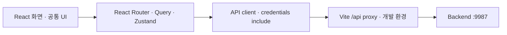

<div align="center">
  
  <h1>주점부리 · Frontend</h1>
  <a href="https://github.com/Pubburi/Frontend/actions/workflows/ci.yml"></a>
</div>

<br />

## 📄 목차

- [프로젝트 개요](#overview)
- [현재 기능과 범위](#features)
- [기술 스택](#technology)
- [시스템 구조](#architecture)
- [문제 해결](#problem-solving)
- [로컬 실행](#development)
- [검증과 협업](#verification)
- [개발 계획](#roadmap)

<br />

<a id="overview"></a>

## ✍ 프로젝트 개요

주점부리에서 상품을 찾고 비교하는 웹입니다. 회원은 후기를 쓰거나 비공개로 취향을 기록하고, 장바구니에 담은 상품으로 데모 주문을 접수합니다. 관리자는 상품 정보와 주문을 관리합니다.

<a id="features"></a>

## 🥃 현재 기능과 범위

- 상품을 주종·가격·도수·맛과 향으로 찾습니다. 검색 결과가 없으면 다른 검색어를 제안합니다. 최대 네 상품의 최신 가격과 확인된 특성을 비교할 수 있습니다.
- 홈에서 입문·선물·음식에 맞는 상품과 데모 매장 정보를 봅니다. 저장한 취향이 있으면 추천 이유를 확인하거나 다른 후보를 요청할 수 있습니다.
- 회원은 취향과 계정 정보를 수정하고, 찜한 상품과 최근 본 상품을 다시 엽니다. 비회원 열람 기록은 기기에 최대 20개를 30일간, 회원 기록은 로그인 중에만 보관합니다.
- 계정 장바구니와 기기 장바구니를 선택해 합칩니다. 데모 주문을 접수한 뒤 주문 당시 금액과 처리 상태를 확인합니다.
- 공개 후기를 작성하거나 나만 보는 경험과 관심을 기록합니다. 주문 처리와 후기 삭제는 내부 알림에서 확인합니다.
- 관리자는 상품·특성과 출처, 매장·회원 정보를 수정하고, 후기를 삭제하거나 데모 주문을 완료 처리합니다.

<a id="technology"></a>

## ⚙️ 기술 스택

| 분류 | 기술 스택 |
|---|---|
| 언어 | TypeScript · CSS |
| UI | React |
| 라우팅 | React Router |
| 서버 상태 | TanStack Query |
| 클라이언트 상태 | Zustand |
| 개발·빌드 | Vite · Node.js · npm |
| 정적 자산 | WebP · sharp |
| 테스트 | Vitest · jsdom · Playwright |
| CI | GitHub Actions |

<a id="architecture"></a>

## 🏛️ 시스템 구조



<a id="problem-solving"></a>

## 🧩 문제 해결

### 응답 유실·로그인 변경에도 장바구니 작업을 중복 반영하지 않기

#### 문제

계정 장바구니를 검증하던 중 병합 응답을 받지 못하고 계정을 바꿨다가 돌아오면, 기기에 담은 2개가 계정 장바구니에 4개로 합산됐다. 서버가 작업을 접수한 뒤 401을 돌려주면 원래 접수를 조회할 정보도 사라졌다.

#### 원인

로그인 캐시를 비울 때 미확정 작업의 식별자도 버렸다. 접수 조회가 404여도 먼저 보낸 요청이 나중에 반영될 수 있다. 쓰기를 끝낸 서버가 응답 전에 인증을 다시 확인하면 401도 반환할 수 있다.

#### 해결

화면을 소유한 계정, 진행 중인 HTTP 요청, 계정별 미확정 작업을 따로 관리했다. 401이나 재로그인 뒤에는 처음 요청의 접수 결과를 조회한다. 조회가 404면 기기 원본과 식별자를 유지하고 새 작업을 막는다. 사용자가 안전 종료를 누르면 서버는 접수 결과를 돌려주거나 같은 식별자의 후속 실행을 차단한다. 접수를 확인한 경우에만 기기에서 실제로 제출한 수량을 뺀다. 늦게 도착한 이전 계정의 응답은 현재 화면과 입력을 건드릴 수 없다.

#### 결과

응답이 유실되거나 지연된 조건에서 기기 수량이 한 번만 반영됐다. 인증이 바뀌어도 새 주문을 만들지 않고 원래 접수를 확인했다. PostgreSQL·JPA를 연결한 일반 화면과 좁은 화면에서 기기 병합, 수량 충돌 복구, 주문 당시 금액과 계정 격리를 확인했다.

#### 대체안/회고

실패할 때마다 새 식별자를 발급하면 서버에서 먼저 처리 중인 작업을 막을 수 없었다. 서버에 종료를 기록하고 화면에서 같은 작업의 접수만 조회하도록 했다. 복구 정보는 현재 탭에 남는다. 새로고침 뒤에는 장바구니와 주문 내역을 확인해야 한다.

#### 코드

같은 계정에서 제출한 작업의 접수가 확인되면 기기 제출분을 정리한다.

```ts
if (!owns(scope) || recoveries.get(scope.id) !== op) return null
publish(scope, cart)
if (result.status === 'APPLIED' && op.guest) cartStore.getState().consume(op.guest)
// A new login does not restore the old form's ownership or redirect intent.
recoveries.delete(scope.id)
```

<a id="development"></a>

## 🚀 로컬 실행

Node.js 24와 실행 중인 Backend가 필요합니다. 세 서버와 DB를 함께 실행하는 방법은 [로컬 통합 실행](https://github.com/Pubburi/Backend/blob/main/docs/LOCAL-DEVELOPMENT.md)에 있습니다.

```bash
cp .env.example .env
npm ci
./scripts/dev.sh
```

- 웹은 http://localhost:5173에서 열립니다. 포트는 `PUBBURI_FRONTEND_PORT`로 지정합니다. 지정한 포트가 사용 중이면 실행을 종료합니다.
- API 주소의 기본값은 `/api`입니다. 개발 프록시는 `VITE_API_PROXY_TARGET`의 Backend로 전달합니다. 기본 대상은 `http://127.0.0.1:9987`입니다.
- 세션 인증에는 `credentials: include`를 사용합니다. 브라우저에서 읽을 수 있는 `VITE_` 변수에는 공개 설정만 넣습니다.
- 이미지 변환은 `npm run optimize:images`로 실행합니다. 새 이미지는 `public/images`의 기존 WebP와 중복되는지 먼저 확인합니다.

<a id="verification"></a>

## ✅ 검증과 협업

```bash
npm ci
npx playwright install chromium
npm run check
```

검증 절차는 [테스트·CI 안내](docs/TESTING.md)에 있습니다. main은 `frontend-ci`를 통과하고 최신 main을 반영한 PR을 Squash merge합니다. 자동화 PR은 최신 커밋의 Codex 리뷰와 대화 해결을 확인합니다. [협업 기준](CONTRIBUTING.md)

<a id="roadmap"></a>

## 🗺️ 개발 계획

필수 MVP 기능 R01–R08과 F01–F12의 검증 기한은 **2026년 12월 31일**, 최종 인계일은 **2027년 2월 5일**입니다. 기능별 상태와 완료 기준은 [프론트 개발 계획](docs/ROADMAP.md)에서 확인할 수 있습니다.
