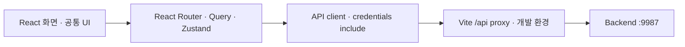

<div align="center">
  
  <h1>주점부리 · Frontend</h1>
  <a href="https://github.com/Pubburi/Frontend/actions/workflows/ci.yml"></a>
</div>

<br />

## 📄 목차

- [프로젝트 개요](#overview)
- [현재 기능과 범위](#features)
- [기술 스택](#technology)
- [시스템 구조](#architecture)
- [문제 해결](#problem-solving)
- [로컬 실행](#development)
- [검증과 협업](#verification)
- [개발 계획](#roadmap)

<br />

<a id="overview"></a>

## ✍ 프로젝트 개요

주점부리에서 상품을 찾고 비교하는 웹입니다. 회원은 후기를 쓰거나 비공개로 취향을 기록하고, 장바구니에 담은 상품으로 데모 주문을 접수합니다. 관리자는 상품 정보와 주문을 관리합니다.

<a id="features"></a>

## 🥃 현재 기능과 범위

- 상품을 주종·가격·도수·맛과 향으로 찾습니다. 검색 결과가 없으면 다른 검색어를 제안합니다. 최대 네 상품의 최신 가격과 확인된 특성을 비교할 수 있습니다.
- 홈에서 입문·선물·음식에 맞는 상품과 데모 매장 정보를 봅니다. 저장한 취향이 있으면 추천 이유를 확인하거나 다른 후보를 요청할 수 있습니다.
- 회원은 취향과 계정 정보를 수정하고, 찜한 상품과 최근 본 상품을 다시 엽니다. 비회원 열람 기록은 기기에 최대 20개를 30일간, 회원 기록은 로그인 중에만 보관합니다.
- 계정 장바구니와 기기 장바구니를 선택해 합칩니다. 데모 주문을 접수한 뒤 주문 당시 금액과 처리 상태를 확인합니다.
- 공개 후기를 작성하거나 나만 보는 경험과 관심을 기록합니다. 주문 처리와 후기 삭제는 내부 알림에서 확인합니다.
- 관리자는 상품·특성·출처, 매장, 회원, 후기, 주문을 편집합니다.

<a id="technology"></a>

## ⚙️ 기술 스택

| 분류 | 기술 스택 |
|---|---|
| 언어 | TypeScript · CSS |
| UI | React |
| 라우팅 | React Router |
| 서버 상태 | TanStack Query |
| 클라이언트 상태 | Zustand |
| 개발·빌드 | Vite · Node.js · npm |
| 정적 자산 | WebP · sharp |
| 테스트 | Vitest · jsdom · Playwright |
| CI | GitHub Actions |

<a id="architecture"></a>

## 🏛️ 시스템 구조



<a id="problem-solving"></a>

## 🧩 문제 해결

### 1. 응답 유실·로그인 변경에도 장바구니 작업을 중복 반영하지 않기

#### 문제

계정 장바구니를 검증하던 중 병합 응답을 받지 못하고 계정을 바꿨다가 돌아오면, 기기에 담은 2개가 계정 장바구니에 4개로 합산됐다. 서버가 작업을 접수한 뒤 401을 돌려주면 원래 접수를 조회할 정보도 사라졌다.

#### 원인

로그인 캐시를 비울 때 미확정 작업의 식별자도 버렸다. 접수 조회가 404여도 먼저 보낸 요청이 나중에 반영될 수 있다. 쓰기를 끝낸 서버가 응답 전에 인증을 다시 확인하면 401도 반환할 수 있다.

#### 해결

화면을 소유한 계정, 진행 중인 HTTP 요청, 계정별 미확정 작업을 따로 관리했다. 401이나 재로그인 뒤에는 처음 요청의 접수 결과를 조회한다. 조회가 404면 기기 원본과 식별자를 유지하고 새 작업을 막는다. 사용자가 안전 종료를 누르면 서버는 접수 결과를 돌려주거나 같은 식별자의 후속 실행을 차단한다. 접수를 확인한 경우에만 기기에서 실제로 제출한 수량을 뺀다. 늦게 도착한 이전 계정의 응답은 현재 화면과 입력을 건드릴 수 없다.

#### 결과

응답이 유실되거나 지연된 조건에서 기기 수량이 한 번만 반영됐다. 인증이 바뀌어도 새 주문을 만들지 않고 원래 접수를 확인했다. PostgreSQL·JPA를 연결한 일반 화면과 좁은 화면에서 기기 병합, 수량 충돌 복구, 주문 당시 금액과 계정 격리를 확인했다.

#### 대체안/회고

실패할 때마다 새 식별자를 발급하면 서버에서 먼저 처리 중인 작업을 막을 수 없었다. 서버에 종료를 기록하고 화면에서 같은 작업의 접수만 조회하도록 했다. 복구 정보는 현재 탭에 남는다. 새로고침 뒤에는 장바구니와 주문 내역을 확인해야 한다.

#### 코드

같은 계정에서 제출한 작업의 접수가 확인되면 기기 제출분을 정리한다.

```ts
if (!owns(scope) || recoveries.get(scope.id) !== op) return null
publish(scope, cart)
if (result.status === 'APPLIED' && op.guest)
  cartStore.getState().consume(op.guest)
recoveries.delete(scope.id)
```

### 2. 검색·상세 경로별로 서버 상태를 분리해 늦은 응답 보호하기

#### 문제

검색 응답 전에 필터를 해제하면 새 검색이 실행되지 않았다. 상품 상세가 로딩 중일 때 다른 상품을 열면 새 상세를 표시하지 못했다. Vue에서 해결한 응답 순서 문제를 React 화면에서도 다뤄야 했다.

#### 원인

검색과 상세가 요청 중복을 막는 상태와 응답 저장 위치를 공유했다. 처리 중인 요청이 있으면 새 요청도 중복으로 봤고, 먼저 보낸 요청이 나중에 도착해도 같은 위치에 저장됐다.

#### 해결

검색 조건 전체를 TanStack Query의 `queryKey`에 넣고 화면은 현재 URL의 조건에 해당하는 쿼리를 구독한다. 상품 상세는 상품 ID, 후기는 상품 ID·정렬·페이지로 구분한다. 상세 컴포넌트도 상품 ID에 맞춰 교체해 이전 상품의 수량과 편집 상태를 버린다. 읽기 오류는 해당 요청을 보낸 화면에서 표시하고, 쓰기는 Zustand의 `pending` 상태를 확인해 중복을 막는다.

#### 결과

검색 중 필터를 해제해도 새 URL의 상품 목록이 열렸다. 이미 떠난 상세의 응답이나 오류가 늦게 도착해도 현재 상품과 오류 안내가 그대로 유지됐다. 이전 요청이 끝났을 때 새 요청의 로딩도 유지됐다.

#### 대체안/회고

전역 목록에 응답을 저장하고 별도의 요청 번호를 관리할 수도 있었다. 검색 조건을 키로 쓰면 TanStack Query의 캐시가 요청별 상태를 관리한다. 관리자 화면과 회원 주문도 각각 화면과 계정에 맞는 키를 사용한다. 이미 보낸 GET은 서버에서 완료될 수 있다.

#### 코드

```tsx
const products = useQuery<Page<Product>>({
  queryKey: ['catalog', 'products', filters],
  queryFn: () => api.products(filters),
  enabled: !invalidUrlFilters,
  refetchOnReconnect: (query) => !(query.state.error instanceof ApiClientError && query.state.error.status === 400),
})
```

상세와 후기의 요청은 각각 현재 상품과 정렬·페이지를 사용한다.

```tsx
const product = useQuery<Product>({
  queryKey: ['catalog', 'product', id],
  queryFn: () => api.product(id),
})
const comments = useQuery<ReviewPage>({
  queryKey: ['reviews', id, sort, page],
  queryFn: () => api.comments(id, { page, size: 10, sort, includeSummary: true, includeTasteTags: true }),
  enabled: product.isSuccess,
})
```

### 3. 삭제 처리 중 활성 버튼이 없어도 확인창의 키보드 포커스 유지하기

#### 문제

관리자가 삭제를 요청하면 응답이 올 때까지 취소와 삭제 버튼이 모두 비활성화된다. 이때 Tab을 누르면 확인창이 열린 채 포커스가 배경으로 빠졌다.

#### 원인

확인창 내부의 keydown에서 활성 버튼의 처음과 끝만 확인했다. 비활성화로 포커스가 확인창 밖으로 이동하거나 활성 버튼이 하나도 없으면 기존 로직이 포커스를 되돌릴 수 없었다.

#### 해결

확인창이 열려 있는 동안 `document`의 캡처 단계에서 키 입력을 받는다. 활성 버튼이 없으면 확인창에 포커스를 둔다. 버튼이 활성화되면 정방향과 역방향 순환을 복원한다. `ref`에서 최신 처리 상태와 취소 함수를 읽고, 닫을 때 리스너를 제거한 뒤 원래 버튼이 남아 있으면 포커스를 돌려준다.

#### 결과

일반 화면과 좁은 화면에서 삭제 응답을 기다리는 동안 포커스가 확인창에 머물렀다. 실패 응답을 받은 뒤에는 Tab과 Shift+Tab으로 순환하고 Escape로 닫은 뒤 원래 버튼으로 돌아갔다. 처리 중 Escape를 차단하고 삭제 요청을 한 번만 보내는 동작도 확인했다.

#### 대체안/회고

네이티브 `dialog`나 포커스 라이브러리를 쓸 수도 있었다. 기존 공통 확인창의 삭제 정책을 유지하면서 이미 배경으로 빠진 포커스를 되돌릴 수 있는 위치에 처리를 뒀다. 확인 범위는 버튼을 가진 단일 확인창과 키보드 조작이다.

#### 코드

```tsx
if (!first || !last) {
  event.preventDefault()
  root.focus()
} else if (!root.contains(focused) || focused === root) {
  event.preventDefault()
  const target = event.shiftKey ? last : first
  target.focus()
} else if (event.shiftKey && focused === first) {
  event.preventDefault()
  last.focus()
} else if (!event.shiftKey && focused === last) {
  event.preventDefault()
  first.focus()
}
```

### 4. 인증 소유와 조회 상태를 분리해 비공개 기록·후기 초안 보호하기

#### 문제

세션이 만료된 뒤 비공개 기록을 저장하면 편집창만 사라지고 목록에는 개인 메모, 평점과 태그가 남았다. 같은 계정의 로그인 상태를 다시 읽을 때는 작성 중이던 공개 후기가 초기화됐다.

#### 원인

기록 API의 401을 편집 폼 안에서 처리해 목록을 관리하는 상위 화면은 계정이 여전히 유효하다고 판단했다. 후기 초안의 소유자도 일시적인 제출 가능 상태로 판정해, 인증을 다시 확인하는 대기 상태에서 초안을 지웠다.

#### 해결

현재 계정에서 받은 401을 상위 화면에 전달해 목록과 편집을 함께 숨기고, 사용자가 인증을 다시 확인한 뒤 기록을 읽는다. 이전 계정의 늦은 응답은 무시한다. 후기 초안은 인증 쿼리, 계정 ID, 역할과 실제 인증 전환에 묶었다. 같은 계정의 인증을 확인하는 동안에는 입력을 숨긴 채 메모리에 초안을 보관하고, 인증이 바뀌면 폐기한다.

#### 결과

실제 서버의 세션을 브라우저 밖에서 종료한 뒤 저장, 삭제, 편집 조회를 시도했다. 인증을 다시 확인하기 전에는 개인 카드와 입력이 표시되지 않았다. 일반 화면과 좁은 화면에서 기록을 펼쳐 로그인 상태를 읽어도 후기 본문, 평점과 맛 태그를 보존했다. 조회 실패 뒤 같은 계정으로 돌아올 때와 다시 로그인할 때의 초안 처리도 확인했다.

#### 대체안/회고

재조회마다 초안을 지우면 로그인 상태만 확인해도 입력을 잃는다. 편집 폼에서만 오류를 처리하면 비공개 목록이 남는다. 계정 소유와 조회 상태를 분리했다. 브라우저 밖의 세션 변경은 다음 API 응답으로 확인하며, 기록을 쓸 때 서버도 소유자와 수정 버전을 검사한다.

#### 코드

```tsx
if (error instanceof ApiClientError && error.status === 401 && sameActor()) {
  active.current = null
  setVerified(null); setFailed('expired')
}
```

```tsx
if (account.auth !== auth || account.id !== session.data?.id ||
    account.role !== session.data?.role || account.transitioning !== transitioning) {
  const next = { auth, id: session.data?.id, role: session.data?.role, transitioning }
  currentAccount.current = next
  focusIntent.current = null
  saveFocus.current = null
  setAccount(next)
  setDraft({ rating: 5, comment: '', tasteTags: [] })
  setEditing(null)
  setDeleting(null)
}
```

<a id="development"></a>

## 🚀 로컬 실행

Node.js 24와 실행 중인 Backend가 필요합니다. 세 서버와 DB를 함께 실행하는 방법은 [로컬 통합 실행](https://github.com/Pubburi/Backend/blob/main/docs/LOCAL-DEVELOPMENT.md)에 있습니다.

```bash
cp .env.example .env
npm ci
./scripts/dev.sh
```

- 웹은 http://localhost:5173에서 열립니다. 포트는 `PUBBURI_FRONTEND_PORT`로 지정합니다. 지정한 포트가 사용 중이면 실행을 종료합니다.
- API 주소의 기본값은 `/api`입니다. 개발 프록시는 `VITE_API_PROXY_TARGET`의 Backend로 전달합니다. 기본 대상은 `http://127.0.0.1:9987`입니다.
- 세션 인증에는 `credentials: include`를 사용합니다. 브라우저에서 읽을 수 있는 `VITE_` 변수에는 공개 설정만 넣습니다.
- 이미지 변환은 `npm run optimize:images`로 실행합니다. 새 이미지는 `public/images`의 기존 WebP와 중복되는지 먼저 확인합니다.

<a id="verification"></a>

## ✅ 검증과 협업

```bash
npm ci
npx playwright install chromium
npm run check
```

검증 절차는 [테스트·CI 안내](docs/TESTING.md)에 있습니다. main은 `frontend-ci`를 통과하고 최신 main을 반영한 PR을 Squash merge합니다. 자동화 PR은 최신 커밋의 Codex 리뷰와 대화 해결을 확인합니다. [협업 기준](CONTRIBUTING.md)

<a id="roadmap"></a>

## 🗺️ 개발 계획

필수 MVP 기능 R01–R08과 F01–F12의 검증 기한은 **2026년 12월 31일**, 최종 인계일은 **2027년 2월 5일**입니다. 기능별 상태와 완료 기준은 [프론트 개발 계획](docs/ROADMAP.md)에서 확인할 수 있습니다.
